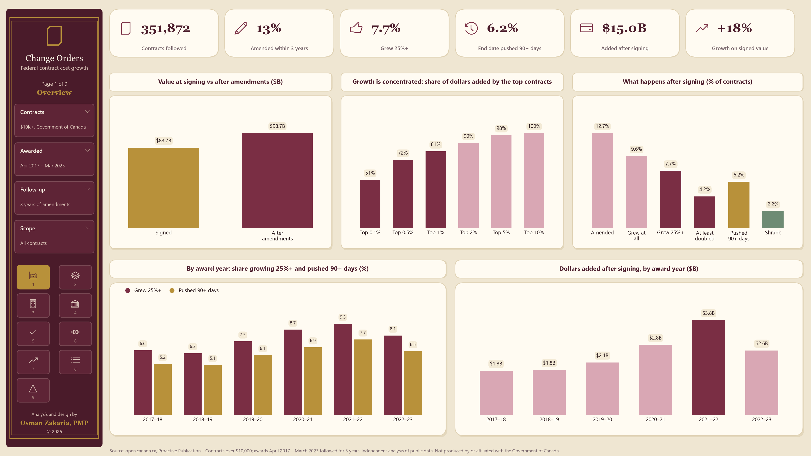
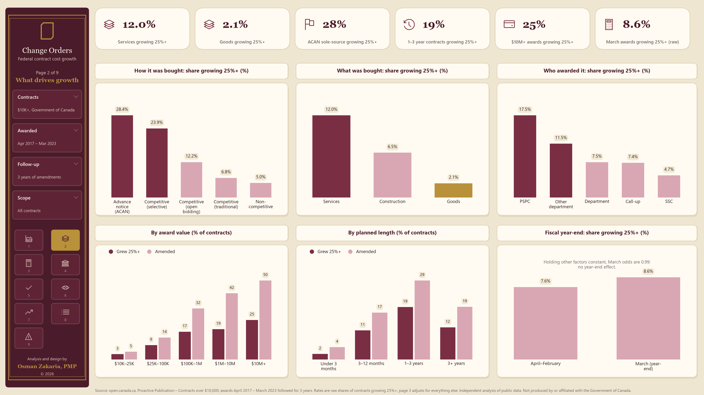
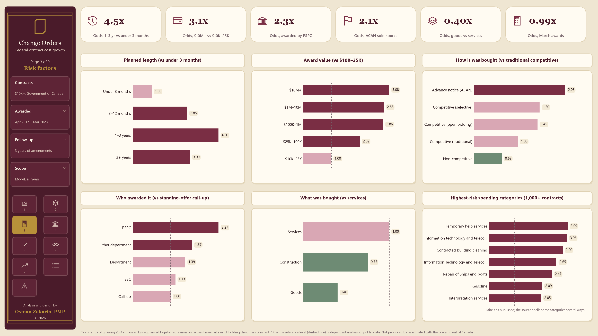
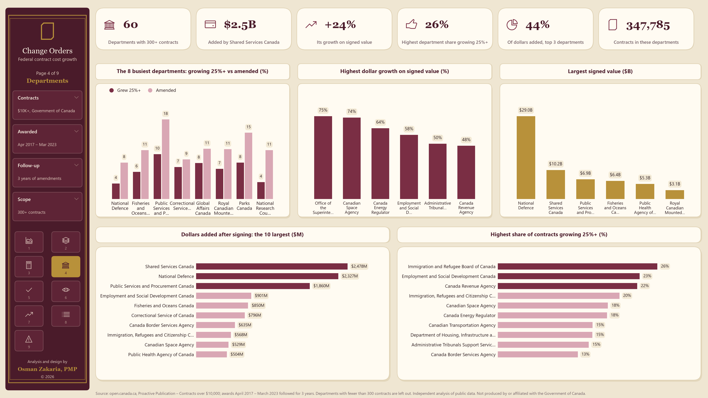
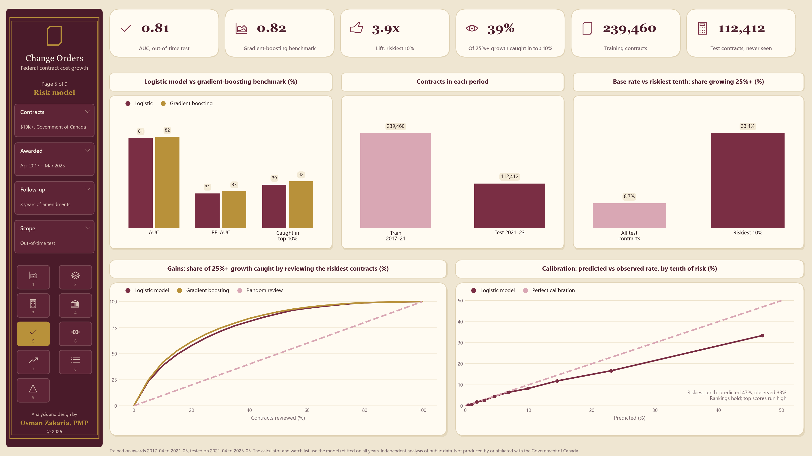
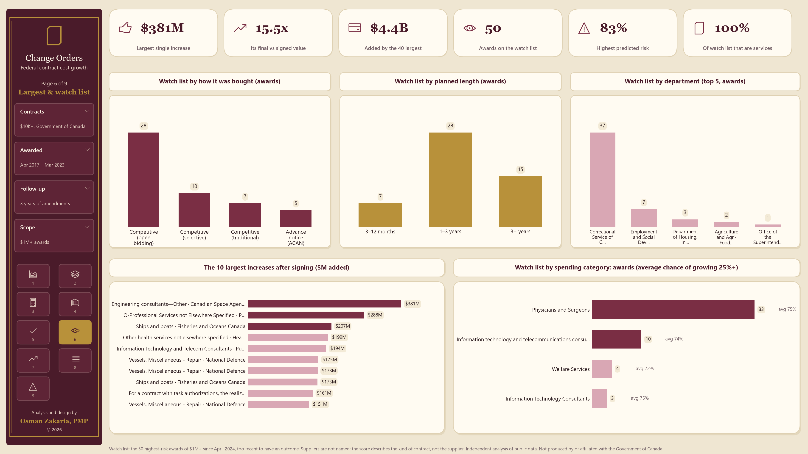
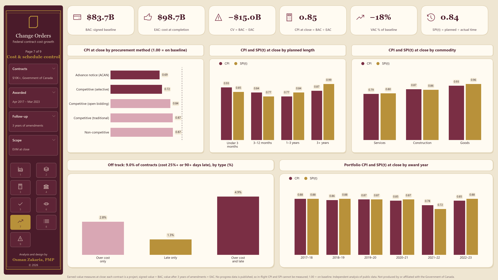
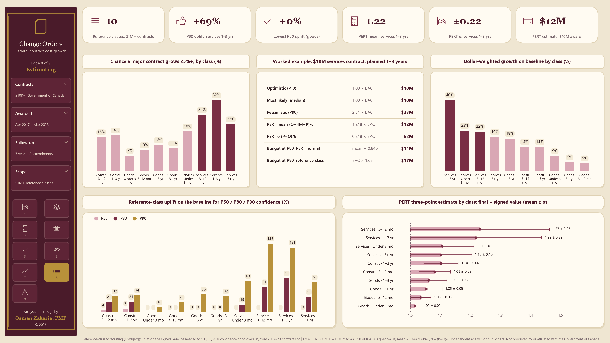
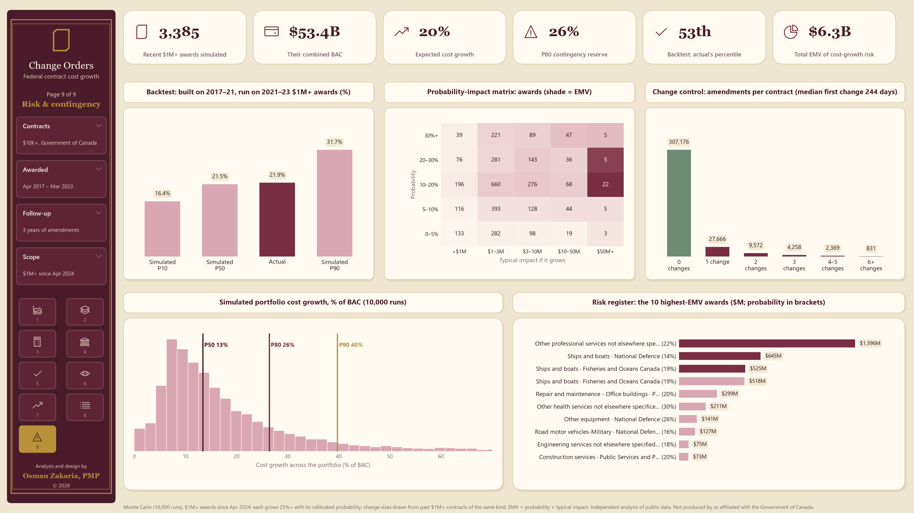

# Change Orders: Federal Contract Cost Growth

**Signed at one price. Finished at another.** How often do Government of Canada contracts grow after they are signed, by how much, and which new contracts are most likely to? This project follows every federal contract over $10,000 awarded from April 2017 to March 2023 through three years of amendments. It finds where cost growth and schedule extensions concentrate, and builds an explainable award-day risk score for change control. It then applies project-management controls to the portfolio: earned-value performance at close, reference-class forecasting, PERT estimating, a Monte Carlo contingency reserve backtested against what actually happened, and an EMV risk register.

Independent analysis of public data. Not produced by or affiliated with the Government of Canada.

## Findings

| | |
|---|---|
| Contracts followed (awarded Apr 2017 – Mar 2023, $10K+) | 351,872 |
| Amended within 3 years | 13% (1.7 amendments each) |
| Grew 25% or more | 7.7% (4.2% at least doubled) |
| End date pushed back 90+ days | 6.2% (median extension one year) |
| Value at signing → after amendments | $83.7B → $98.7B (+$15.0B, +18%) |

- **Growth is concentrated.** The top 1% of contracts account for 81% of all dollars added after award, and the top 0.1% (about 350 contracts) for 51%. Most contracts finish at or near their signed value, so change control should focus on the few large, long contracts.
- **Length and size matter most.** Holding other factors constant, contracts planned for 1–3 years have 4.5 times the odds of 25%+ growth of those under 3 months. Awards of $10M or more have 3.1 times the odds of $10K–25K awards.
- **How and what was bought matters too.**
  - **Sole-source and central awards:** sole-source awards under an Advance Contract Award Notice (ACAN) have 2.1 times the odds of traditional competitive ones, and contracts awarded by PSPC on a department's behalf have 2.3 times the odds of standing-offer call-ups.
  - **Goods vs services:** services contracts grow 25%+ six times as often as goods contracts (12.0% vs 2.1%).
- **The fiscal year-end rush is a myth for cost growth.** Contracts awarded in March grow no more often than the rest (odds ratio 0.99).
- **Dollars added by department:** Shared Services Canada ($2.5B, +24%), National Defence ($2.3B, +8%) and PSPC ($1.9B, +27%) added the most. Employment and Social Development Canada has the highest share of contracts growing 25%+, at 23%.

**Risk model.** It's trained on 2017–2021 awards and tested on 2021–2023 awards it never saw. It scores an AUC of 0.81, against 0.82 for a gradient-boosting benchmark. Reviewing the riskiest 10% of new contracts catches 39% of those that go on to grow 25% or more, 3.9 times better than chance.

## Project management analysis

Every contract is treated as a small project and run through the controls a PMP would apply to a major program: earned-value performance at close, reference-class forecasting, PERT three-point estimating, Monte Carlo contingency, an expected-monetary-value risk register, a probability-impact matrix and change-control metrics. All of it is in `fco/pm.py`; settings are in `fco/config.py`.

**Cost and schedule performance at close (earned-value measures).** Signed value is the cost baseline (BAC); value after three years of amendments is the cost at completion (EAC).

| Measure | Formula | Portfolio |
|---|---|---|
| Cost variance | CV = BAC − EAC | −$15.0B |
| Cost performance index at close | CPI = BAC ÷ EAC | 0.85 |
| Variance at completion | VAC% = (BAC − EAC) ÷ BAC | −18% |
| Schedule performance index (time) at close | SPI(t) = planned ÷ (planned + slip) | 0.85 |
| Contracts both 25%+ over cost and 90+ days late | | 17,212 (4.9%) |

Sole-source ACAN awards close at a CPI of 0.69 and selective tenders at 0.72, against 0.87 for traditional competitive awards. Services close at 0.79, goods at 0.93. The data has no progress reporting, so in-flight EV, CPI and SPI cannot be measured; these are close-out analogues and are labelled that way.

**Estimating: reference-class forecasting (Flyvbjerg) and PERT.** For major contracts ($1M+), grouped by commodity and planned length, the uplift a new baseline needs for a given confidence of not overrunning:

| Reference class | P50 | P80 | P90 |
|---|---|---|---|
| Services, 1–3 years | +0% | +69% | +131% |
| Services, 3–12 months | +0% | +51% | +139% |
| Construction, 1–3 years | +7% | +21% | +34% |
| Goods, 1–3 years | +0% | +0% | +36% |

PERT uses O, M, P = the P10, median and P90 of final ÷ signed value; mean = (O + 4M + P) ÷ 6, σ = (P − O) ÷ 6. Worked example, a $10M services contract planned for 1–3 years: PERT mean $12.2M, σ $2.2M, so a P80 budget of $14.0M under the normal approximation. The reference class puts P80 at $16.9M. The gap is the point: cost growth is right-skewed, and a symmetric PERT approximation under-reserves for the tail.

**Contingency: Monte Carlo of the live portfolio.** The 3,385 awards of $1M+ since April 2024 (BAC $53.4B) are simulated 10,000 times. Each grows 25%+ with its calibrated model probability, and the size of its change is drawn from past $1M+ contracts of the same commodity and length.

| | Cost growth | % of BAC |
|---|---|---|
| P50 | $7.1B | 13% |
| Expected (mean) | $10.7B | 20% |
| **P80 contingency reserve** | **$14.1B** | **26%** |
| P90 | $21.2B | 40% |

**Backtest.** Built only from 2017–21 awards and run on the 2,955 awards of $1M+ from 2021–23, the simulation's median was 21.5% growth, and actual growth was 21.9%: the 53rd percentile of the simulated range (P10–P90: 16.4%–31.7%).

**Risk register and probability-impact matrix.** EMV = probability × typical impact (the class median change if a contract grows). Total EMV across the live portfolio is $6.3B, and the 10 largest risks hold 64% of it, led by a $11.2B National Defence professional-services award (22% probability, EMV $1.4B). The probability-impact matrix places every award by its calibrated probability and impact.

**Change control.** 44,696 contracts (13%) were amended, 75,806 times in all: 1.7 changes each. The median first change arrives 244 days after award (180 days for construction, 260 for services). Among awards of $1M+, 42% were amended, 2.3 times each.

## 🚀 Live interactive app

Explore the analysis in your browser: what drives growth, every department, a live risk calculator for a new contract, the watch list and the largest increases.

[](https://claude.ai/artifact/4z9ZPCezsJwN5r1m1py6Wy)
[](#run-it)
[](#dashboards)
[](#project-management-analysis)

## Dashboards

Nine 16:9 report pages in [`docs/dashboards/`](docs/dashboards/), also bound together in [`change_orders_dashboards.pdf`](docs/dashboards/change_orders_dashboards.pdf).

### 1 · Overview
Value at signing vs after amendments, how concentrated growth is, what happens to contracts after signing, and the trend by award year.



### 2 · What drives growth
Raw shares of contracts growing 25% or more, by procurement method, commodity, awarding body, value, planned length and award month.



### 3 · Risk factors
Model-adjusted odds ratios for each factor, holding the others constant, and the highest-risk spending categories.



### 4 · Departments
Dollars added, share growing 25%+, dollar growth and signed value for departments with 300+ contracts.



### 5 · Risk model
Out-of-time gains and calibration, and the logistic model against a gradient-boosting benchmark.



### 6 · Largest increases and watch list
The 10 largest increases after signing, and the profile of the 50 highest-risk awards of $1M+ since April 2024.



### 7 · Cost and schedule control
Earned-value measures at close: BAC, EAC, CV, CPI, VAC and SPI(t) for the portfolio, by procurement method, length, commodity and award year, and the contracts that ran over on cost, schedule or both.



### 8 · Estimating
Reference-class forecasting uplifts for P50, P80 and P90 confidence, PERT three-point estimates by class, and a worked $10M example.



### 9 · Risk and contingency
Monte Carlo of the live $1M+ portfolio with its P80 contingency reserve and out-of-time backtest, the probability-impact matrix, the EMV risk register and change-control metrics.



## The app

`outputs/change_orders.html` is self-contained and works offline. It has seven tabs:
- **Overview:** headline numbers, how concentrated growth is, and the trend by award year.
- **What drives growth:** raw rates and model-adjusted odds by procurement method, commodity, value, length, awarding body, bids and award month.
- **Departments:** a sortable table of every department with 300+ contracts.
- **Risk check:** describe a contract on its award day and get the chance of 25%+ growth, with the factors that push it up or down. It computes live in the browser.
- **Watch list:** the 50 highest-risk awards of $1M+ since April 2024, too recent to have an outcome. Suppliers are not named, because the score describes the kind of contract, not the supplier.
- **Largest increases:** the 40 contracts with the most dollars added.
- **Method:** how the numbers are built, and their limits.

## Run it

```bash
python -m pip install -r requirements.txt
```

Download the input file (642 MB, not in this repository): [Proactive Publication – Contracts over $10,000](https://open.canada.ca/data/en/dataset/d8f85d91-7dec-4fd1-8055-483b77225d8b), saved as `data/raw/contracts.csv`. Then:

```bash
python run_all.py
```

The first run takes a few minutes to parse the file, which is cached in `data/cache/`. Use `--rebuild` to re-read it, or `--report` to redraw only the nine report dashboards from `outputs/app_data.json` in seconds.

## Method

1. **One row per contract.** Award rows (instrument type C) are joined to their amendments (type A) by department and normalised procurement number.
   - **Signed value:** the award's total contract value.
   - **Final value:** the total contract value on the latest amendment reported within 3 years of award, plus one quarter for reporting lag.
   - **Schedule extension:** how far the latest amended end date moved past the original one.
2. **Population.** Awards from April 2017 to March 2023, so every contract has a full three years of follow-up. Earlier records don't distinguish amendments from awards.
3. **Data errors.** The 1,062 contracts (0.3%) whose final value is zero or more than 20 times the award are excluded as likely errors, such as cents entered as dollars or cancellations.
4. **Risk model.** An L2-regularised logistic regression on banded factors known at award:
   - department and spending category (economic object)
   - procurement method, commodity, and who awarded it
   - value, planned length, number of bids, and award month

   Each factor reads as an odds ratio. Validation is out-of-time: train on awards to March 2021, test on April 2021 to March 2023. The calculator and watch list use the model refitted on all years.

5. **Project controls.** See [Project management analysis](#project-management-analysis). The Monte Carlo maps model scores to observed rates with the out-of-time calibration table, because the model runs high for its riskiest tenth. Time to first change uses the quarter in which the first amendment was reported.

All assumptions are in `fco/config.py`.

## Code

| File | What it does |
|---|---|
| `fco/config.py` | Study window, thresholds and model settings |
| `fco/data.py` | Reads the contracts file and builds one row per contract with its growth and extension |
| `fco/analysis.py` | Headline numbers, concentration, and breakdowns by factor and department |
| `fco/model.py` | Risk model, out-of-time validation, odds ratios, and the watch list |
| `fco/app.py`, `fco/app_template.html` | The self-contained app |
| `fco/pm.py` | Project controls: EVM at close, reference classes, PERT, Monte Carlo contingency and backtest, EMV register, probability-impact matrix, change control |
| `fco/report.py` | The nine report dashboards (PNG at 220 dpi, plus one PDF), drawn from the app's own data |
| `run_all.py` | Runs everything and writes `outputs/`, including `project_controls.json`, `reference_classes.csv`, `risk_register.csv` and `portfolio_risk_scored.csv` |

## Limits

- **Change is not the same as an overrun.** Amendments include planned options and phases (6% of amended contracts mention an option), added scope and corrections. This measures change after signing, which change control governs, not mismanagement.
- **Rates are a floor.** 66,000 of 205,000 amendments (32%) don't match a published award, mostly because the contract started under $10,000.
- **Data quality varies by department.** Procurement numbers, end dates and bid counts are sometimes missing; most contracts don't report bids.
- **Some growth isn't visible.** Standing offers and supply arrangements appear as individual call-ups, so growth in the underlying arrangement isn't measured.
- **Associations are not causes.** Long, large and sole-source contracts grow more often, partly because they are the kind of work that changes.

## Data licence

Contains information licensed under the [Open Government Licence – Canada](https://open.canada.ca/en/open-government-licence-canada).

Analysis and design by Osman Zakaria, PMP · © 2026 Osman Zakaria, PMP
